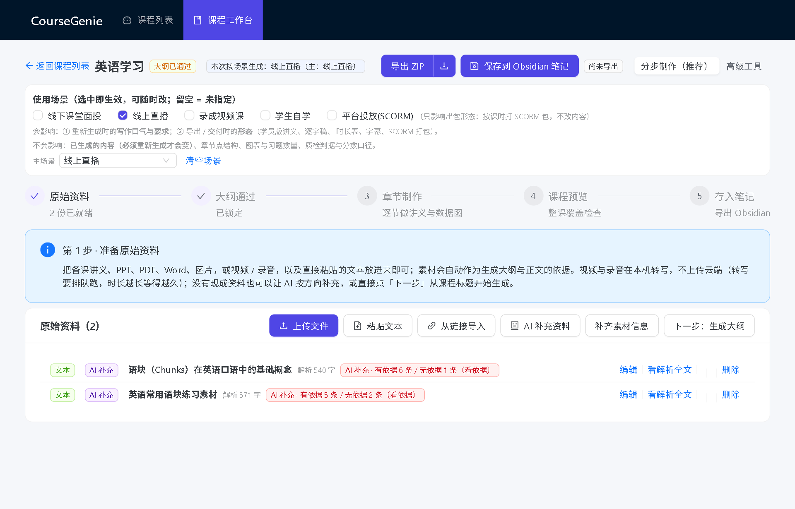
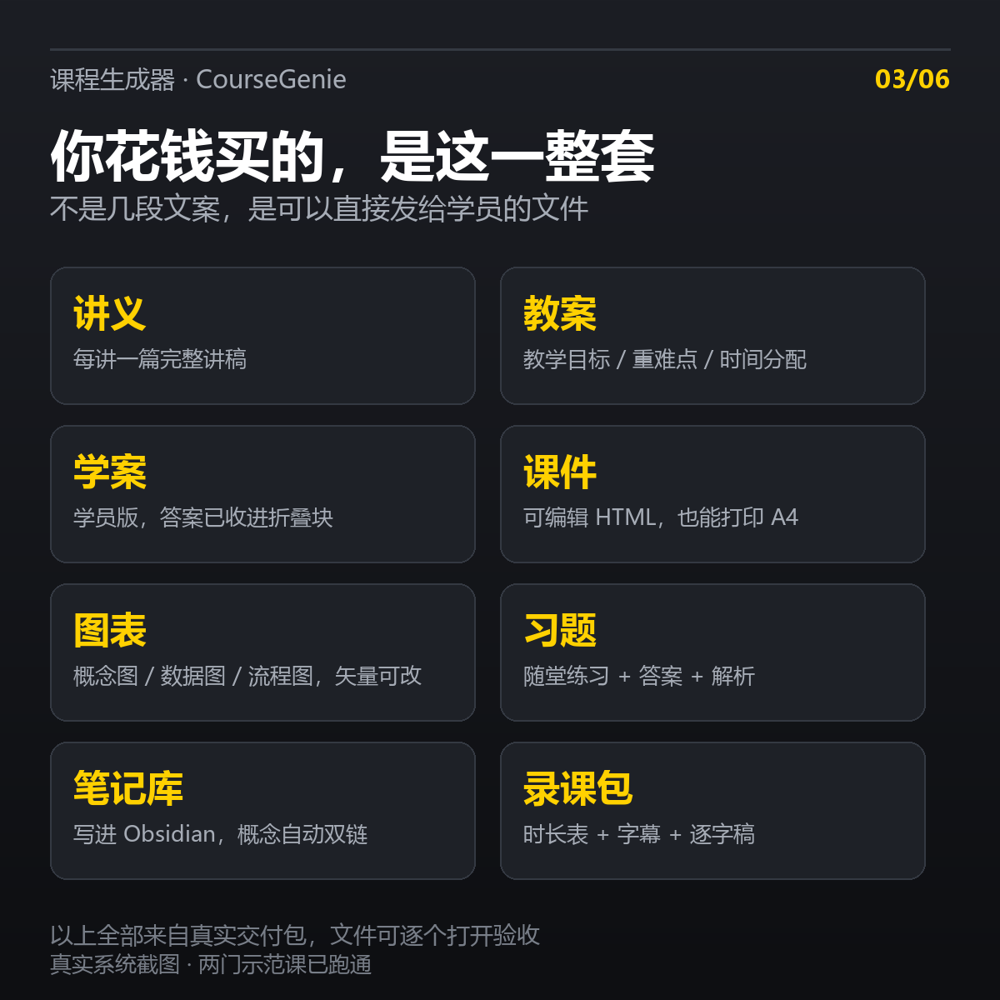

# 课程生成器 · CourseGenie

> 把一份散乱的资料，变成一门**能直接交付给学员**的课：大纲、讲义、教案、学案、可编辑课件、配图、习题、Obsidian 笔记库、录课包。

[](./LICENSE)
[](./backend/requirements.txt)
[](./frontend/package.json)
[](./scripts/verify.ps1)



## 它到底产出什么

不是几段文案——是 8 类可以直接发给学员的文件：

| 交付物 | 内容 |
|---|---|
| 讲义 | 每个知识点一篇完整讲稿 |
| 教案 | 教学目标、重难点、时间分配、提问设计 |
| 学案 | 学员版，答案收进折叠块（打印/在线都对） |
| 课件 | 可编辑 HTML 演示，能导出 PPTX / 打印 A4 横版 |
| 图表 | 概念图 / 数据图 / 流程图，矢量可改，不是 AI 生图 |
| 习题 | 随堂练习 + 答案 + 解析，可指定难度分布 |
| 笔记库 | 写进 Obsidian，概念自动双链，章节目录成 MOC |
| 录课包 | 时长表 + 字幕（SRT）+ 逐字稿 + 录课清单 |



## 真实跑过的两门课

| 课程 | 结构 | 机器评分 | 交付包 |
|---|---|---|---|
| AI 幻觉治理实战 | 12 章 27 讲 | **91.6** | 792 个文件 / 46.9 MB |
| 包子制作入门 | 3 章 6 讲 | **87.0** | 200 个文件 / 12.7 MB |

评分由系统按覆盖度、结构完整性、习题质量、可读性计算，口径在 `backend/app/services/` 里，没有藏。交付包里的每个文件都能打开核对。

## 快速开始

### 方式一：Docker（推荐）

```bash
git clone https://github.com/your-github-name/coursegenie.git
cd coursegenie
cp backend/.env.example backend/.env       # 填 LLM_API_KEY，或先保持 mock
docker compose up --build
# 打开 http://localhost:8000
```

### 方式二：本地跑

```bash
# 后端（Python 3.10+）
cd backend
python -m venv .venv && .venv/Scripts/activate     # Windows；macOS/Linux 用 source .venv/bin/activate
pip install -r requirements.txt
cp .env.example .env
uvicorn app.main:app --reload --port 8000

# 前端（Node 18+，另开一个终端）
cd frontend
npm install
npm run dev            # 开发模式：http://localhost:5173，接口转发到 8000
# 或 npm run build      产物交给后端直接托管，访问 http://localhost:8000
```

**不想花钱接模型？** 默认 `LLM_PROVIDER=mock`，全流程可以用假数据跑通，用来体验界面和交付包结构。要真生成，把它改成 `openai` 并填 key。

## 配置

只列最关键的（完整清单见 `backend/.env.example`）：

| 变量 | 默认 | 说明 |
|---|---|---|
| `LLM_PROVIDER` | `mock` | `openai` / `anthropic` / `mock` |
| `LLM_API_KEY` / `OPENAI_API_KEY` | – | 模型凭据，缺失时回落到 mock |
| `IMAGE_PROVIDER` | `mock` | 配图走哪家；`mock` 时用本地矢量图 |
| `AUTH_ENABLED` | `false` | 多用户与登录；单机自用保持 false |
| `OBSIDIAN_VAULT_ROOT` | – | 导出笔记库的落点目录 |

## 架构

```
frontend/        React 18 + TypeScript + Ant Design + React Query
backend/         FastAPI + SQLAlchemy 2.0 + SQLite
  app/services/  生成流水线（大纲 → 讲义 → 图 → 习题 → 打包）
  app/delivery.py  交付包构建（PDF / ZIP / SCORM / 字幕）
connector/       MCP Server（可装进支持 MCP 的 AI 客户端）
packaging/       技能包 / 专家包（WorkBuddy 生态）
scripts/verify.ps1  一键门禁
```

数据默认落在 `backend/data/`（SQLite）与 `backend/storage/`（素材与交付包），两个目录都不入库。

## 质量门禁

```powershell
# 整仓校验：后端 pytest + 前端 tsc + 构建 + 十余个专项断言脚本
powershell -ExecutionPolicy Bypass -File scripts/verify.ps1
```

当前状态：**78 个步骤全 PASS，pytest 1464 passed / 1 skipped**。改动请先跑门禁再提 PR。

## 已知限制（如实写）

- **单租户**：默认不开多用户鉴权，一台实例对应一个人/一个团队。要做 SaaS 得自己接 `AUTH_ENABLED`。
- **部分功能依赖 Windows**：`PPT_PREVIEW_PDF` 用 PowerPoint COM 导出预览，只在 Windows 有效；其它平台回退成文字大纲。
- **视频/音频转写**需要额外的 ASR 依赖（`requirements-asr.txt`），且吃 CPU。
- **图是矢量图不是 AI 生图**：刻意的取舍——可编辑、可嵌进笔记库、体积小。
- 生成质量取决于模型；`mock` 模式只是为了让你先跑通。

## 不做什么

- 不做「一键生成躺赚」——内容判断还得人来。
- 不接代写学位论文 / 代考 / 抄袭他人课程。
- 不承诺「保证过审」「保证卖爆」。

## 协议

**AGPL-3.0**。你可以自用、改、商用；但如果你把它（或其修改版）作为网络服务提供给他人，**必须同样开源你的修改**。
需要闭源商用 / 贴牌，另谈商业授权。

## 联系

- 问题与建议：开 Issue
- 想直接找人做课（不用自己部署）：见仓库 About 页的联系方式
